<p align="center">
  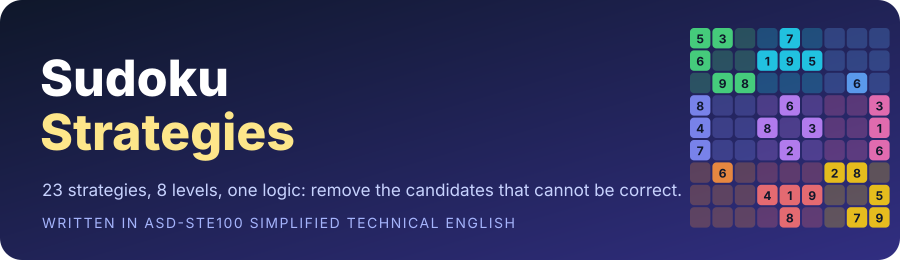
</p>

# Sudoku Strategies

🇮🇹 [Versione italiana](README.md) · 🇬🇧 English version (this page)

This guide gives the logic of 23 Sudoku strategies.
Each strategy has a pattern, the logic of the pattern and one example.
A Python script examined each example. All the examples are correct.

> [!NOTE]
> This guide uses ASD-STE100 Simplified Technical English.
> The sentences are short. Each sentence gives one instruction or one fact.
> The names that are only for Sudoku are technical names.
> The section [Technical names](#technical-names) gives information about each technical name.

---

## Contents

<p align="center">
  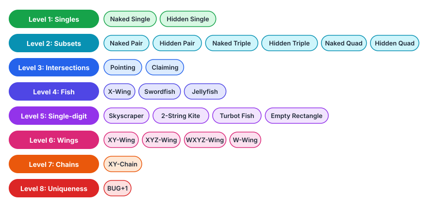
</p>

| Level | Group | Strategies |
|:-:|---|---|
| 1 | Singles | [Naked Single](#1-naked-single) · [Hidden Single](#2-hidden-single) |
| 2 | Subsets | [Naked Pair](#3-naked-pair) · [Hidden Pair](#4-hidden-pair) · [Naked Triple](#5-naked-triple) · [Hidden Triple](#6-hidden-triple) · [Naked Quad](#7-naked-quad) · [Hidden Quad](#8-hidden-quad) |
| 3 | Intersections | [Pointing](#9-pointing) · [Claiming](#10-claiming) |
| 4 | Fish | [X-Wing](#11-x-wing) · [Swordfish](#12-swordfish) · [Jellyfish](#13-jellyfish) |
| 5 | Single-digit chains | [Skyscraper](#14-skyscraper) · [2-String Kite](#15-2-string-kite) · [Turbot Fish](#16-turbot-fish) · [Empty Rectangle](#17-empty-rectangle) |
| 6 | Wings | [XY-Wing](#18-xy-wing) · [XYZ-Wing](#19-xyz-wing) · [WXYZ-Wing](#20-wxyz-wing) · [W-Wing](#21-w-wing) |
| 7 | Chains | [XY-Chain](#22-xy-chain) |
| 8 | Uniqueness | [BUG+1](#23-bug1) |

Other sections:
[The grid](#the-grid) ·
[Technical names](#technical-names) ·
[Colors in the figures](#colors-in-the-figures) ·
[Procedure for all puzzles](#procedure-for-all-puzzles) ·
[About the examples](#about-the-examples)

---

## The grid

<p align="center">
  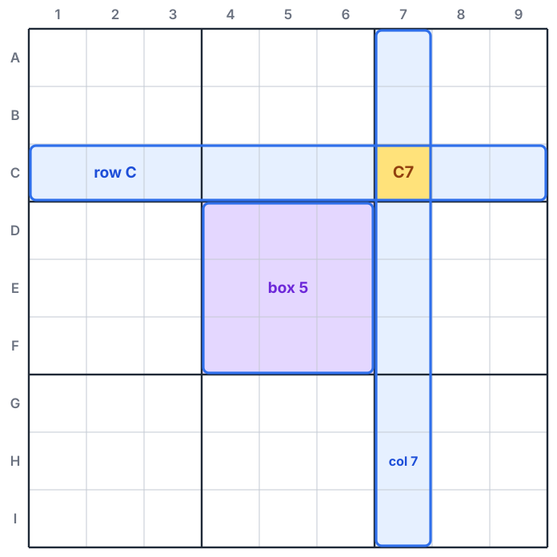
</p>

A Sudoku grid has 81 cells.
The rows have the names A to I, from the top to the bottom.
The columns have the numbers 1 to 9, from the left to the right.
The name of a cell is the name of its row and the number of its column.
For example, cell C7 is in row C and in column 7.

The grid has nine boxes, and each box has 3 × 3 cells.
The boxes have the numbers 1 to 9, from the top left to the bottom right.

**The condition of Sudoku:** each row, each column and each box contains the digits 1 to 9, one time each.

All the strategies in this guide use only this condition.
Each strategy gives one of these two results:

1. It finds the correct digit for a cell.
2. It removes a candidate from a cell.

---

## Technical names

| Technical name | Information |
|---|---|
| **Cell** | The smallest area of the grid. A cell contains one digit. |
| **Unit** | A row, a column or a box. Each unit has 9 cells. |
| **Given** | A digit that is in the grid at the start. |
| **Candidate** | A digit that is possible in an empty cell. |
| **Peer** | Two cells are peers when they are in the same unit. Two peers cannot contain the same digit. |
| **Bivalue cell** | An empty cell that has only two candidates. |
| **Pattern** | A group of cells and candidates that a strategy uses. |
| **Strong link** | A relation between two candidates. If one candidate is not correct, the other candidate is correct. Example: a digit has only two candidates in a unit. |
| **Weak link** | A relation between two candidates. If one candidate is correct, the other candidate is not correct. Example: two candidates of the same digit in two peer cells. |
| **Pivot** | The center cell of a wing. |
| **Pincer** | An end cell of a wing. |
| **Base unit** | A unit that starts a fish pattern. |
| **Cover unit** | A unit where a fish pattern removes candidates. |
| **Solution** | The full grid with all 81 digits. A correct puzzle has only one solution. |

> [!TIP]
> A strong link is also a weak link when the two candidates are peers.
> Chains use this fact. They go from a strong link to a weak link, and then to a strong link again.

---

## Colors in the figures

<p align="center">
  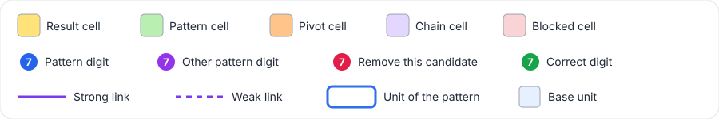
</p>

The figures show only the candidates that are important for the strategy.
Some figures show only one digit.
In these figures, the grid shows all the candidates of that digit.

---

<p align="center"></p>

## 1. Naked Single

**Strategy:** if a cell has only one candidate, that candidate is the correct digit.

**Logic:**
The peers of a cell contain some digits.
The cell cannot contain these digits.
When the peers contain eight different digits, only one digit stays for the cell.

<p align="center">
  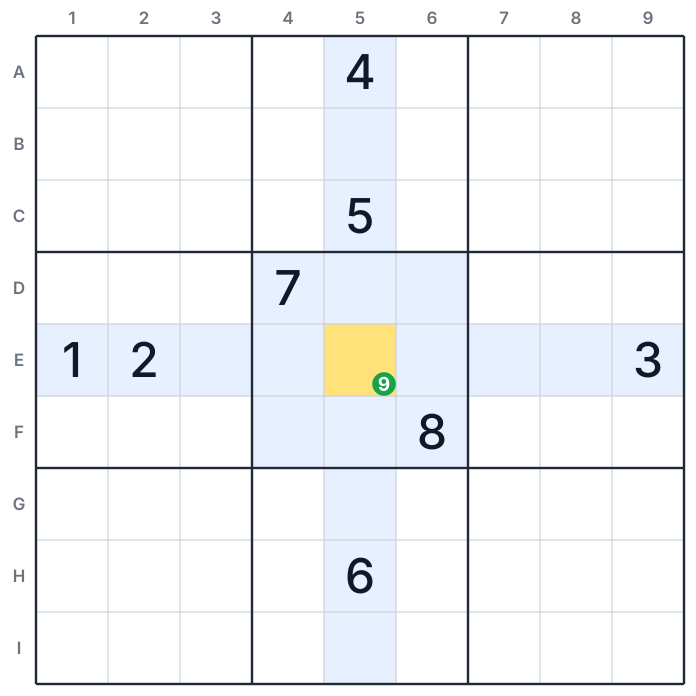
</p>

**Example:**

1. Examine the peers of cell E5.
2. Row E contains 1, 2 and 3.
3. Column 5 contains 4, 5 and 6.
4. Box 5 contains 7 and 8.
5. The peers of E5 contain the digits 1 to 8. Only the digit 9 stays.

**Result:** write 9 in cell E5.

---

## 2. Hidden Single

**Strategy:** if a digit has only one possible cell in a unit, that cell contains the digit.

**Logic:**
Each unit must contain each digit.
A cell can have many candidates.
But if a digit is possible in only one cell of a unit, the digit must be in that cell.
The other candidates of the cell make this digit not easy to find. Thus the name is "hidden".

<p align="center">
  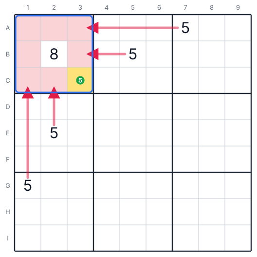
</p>

**Example:**

1. Box 1 must contain a 5. Find the cells of box 1 that can contain a 5.
2. Cell A7 contains a 5. Row A cannot have two 5s. Cells A1, A2 and A3 cannot contain 5.
3. Cell B5 contains a 5. Cells B1 and B3 cannot contain 5. Cell B2 contains 8.
4. Cell G1 contains a 5. Column 1 cannot have two 5s. Cell C1 cannot contain 5.
5. Cell E2 contains a 5. Cell C2 cannot contain 5.
6. In box 1, only cell C3 can contain a 5.

**Result:** write 5 in cell C3.

---

<p align="center"></p>

## 3. Naked Pair

**Strategy:** two cells in one unit have the same two candidates, and no other candidates.
Remove these two digits from all the other cells of the unit.

**Logic:**
The two cells must contain the two digits.
If one cell contains one of the digits, the other cell contains the other digit.
In the two conditions, the two digits are in these two cells.
No other cell of the unit can contain these two digits.

<p align="center">
  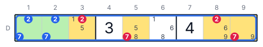
</p>

**Example (row D):**

1. Cells D1 and D2 have only the candidates 2 and 7.
2. If D1 is 2, then D2 is 7. If D1 is 7, then D2 is 2.
3. The digits 2 and 7 are in D1 and D2. They cannot be in other cells of row D.

**Result:**

| Cell | Remove |
|:-:|:-:|
| D3 | 2 |
| D8 | 2 |
| D5 | 7 |
| D9 | 7 |

After this step, D9 has only the candidate 9. D9 is a naked single.

> [!TIP]
> If the two cells are also in the same box, remove the two digits from that box too.

---

## 4. Hidden Pair

**Strategy:** in one unit, two digits are candidates in only the same two cells.
Remove all the other candidates from these two cells.

**Logic:**
The unit must contain the two digits.
Only two cells can contain them.
Thus one cell contains one digit, and the other cell contains the other digit.
These two cells cannot contain a different digit.

<p align="center">
  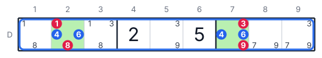
</p>

**Example (row D):**

1. Find the cells of row D that can contain 4. Only D2 and D7 can contain 4.
2. Find the cells of row D that can contain 6. Only D2 and D7 can contain 6.
3. The digits 4 and 6 must be in D2 and D7.

**Result:**

| Cell | Remove |
|:-:|:-:|
| D2 | 1 and 8 |
| D7 | 3 and 9 |

After this step, D2 and D7 are a naked pair.

---

## 5. Naked Triple

**Strategy:** three cells in one unit have candidates from the same three digits only.
Remove these three digits from all the other cells of the unit.

**Logic:**
Three cells must contain three different digits.
These cells have only three possible digits.
Thus the three cells use the three digits.
No other cell of the unit can contain these digits.

> [!IMPORTANT]
> Each cell of the triple does not have to contain all three digits.
> In the example, each cell has only two of the three digits.

<p align="center">
  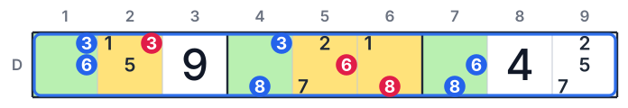
</p>

**Example (row D):**

1. Cell D1 has the candidates 3 and 6.
2. Cell D4 has the candidates 3 and 8.
3. Cell D7 has the candidates 6 and 8.
4. Together, the three cells have only the digits 3, 6 and 8.

**Result:**

| Cell | Remove |
|:-:|:-:|
| D2 | 3 |
| D5 | 6 |
| D6 | 8 |

After this step, D6 has only the candidate 1. D6 is a naked single.

---

## 6. Hidden Triple

**Strategy:** in one unit, three digits are candidates in only three cells.
Remove all the other candidates from these three cells.

**Logic:**
The unit must contain the three digits.
Only three cells can contain them.
Thus these three cells contain these three digits, and no other digit.

<p align="center">
  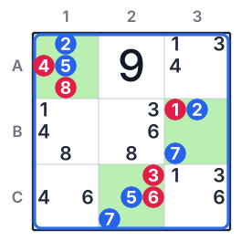
</p>

**Example (box 1):**

1. The digit 2 is a candidate only in A1 and B3.
2. The digit 5 is a candidate only in A1 and C2.
3. The digit 7 is a candidate only in B3 and C2.
4. The digits 2, 5 and 7 must be in the three cells A1, B3 and C2.

**Result:**

| Cell | Remove |
|:-:|:-:|
| A1 | 4 and 8 |
| B3 | 1 |
| C2 | 3 and 6 |

---

## 7. Naked Quad

**Strategy:** four cells in one unit have candidates from the same four digits only.
Remove these four digits from all the other cells of the unit.

**Logic:**
The logic is the same as the logic of the naked pair and the naked triple.
Four cells must contain four different digits, and they have only four possible digits.

<p align="center">
  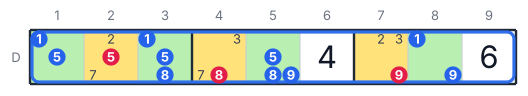
</p>

**Example (row D):**

1. The cells D1, D3, D5 and D8 have only the digits 1, 5, 8 and 9.
2. These four digits must be in these four cells.

**Result:**

| Cell | Remove |
|:-:|:-:|
| D2 | 5 |
| D4 | 8 |
| D7 | 9 |

---

## 8. Hidden Quad

**Strategy:** in one unit, four digits are candidates in only four cells.
Remove all the other candidates from these four cells.

<p align="center">
  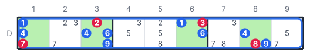
</p>

**Example (row D):**

1. The digits 1, 4, 6 and 9 are candidates only in D1, D3, D6 and D8.
2. These four digits must be in these four cells.

**Result:**

| Cell | Remove |
|:-:|:-:|
| D1 | 7 |
| D3 | 2 |
| D6 | 3 |
| D8 | 8 |

> [!TIP]
> **Each naked subset has a hidden subset in the same unit.**
> Count the empty cells in a unit. If a naked subset uses some of these cells, the other empty cells make a hidden subset.
> Use the subset with the smaller number of cells. It is easier to find.

| Number of cells | Naked (cells → digits) | Hidden (digits → cells) |
|:-:|---|---|
| 2 | Naked Pair | Hidden Pair |
| 3 | Naked Triple | Hidden Triple |
| 4 | Naked Quad | Hidden Quad |

---

<p align="center"></p>

The strategies of level 3 use the cells that are in a box and also in a row (or a column).
The name for the two strategies is **Intersection Removal**.

## 9. Pointing

**Strategy:** in a box, a digit is a candidate only in one row (or one column).
Remove that digit from the cells of that row (or column) that are not in the box.

**Logic:**
The box must contain the digit.
All the candidates of the digit in the box are in one row.
Thus the digit of that row is in the box.
The other cells of the row cannot contain the digit.

<p align="center">
  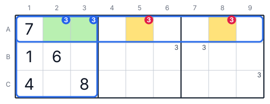
</p>

**Example (digit 3):**

1. Box 1 must contain a 3.
2. In box 1, only A2 and A3 can contain 3. These two cells are in row A.
3. The 3 of row A is in A2 or in A3.

**Result:** remove 3 from A5 and from A8.

---

## 10. Claiming

**Strategy:** in a row (or a column), a digit is a candidate only in one box.
Remove that digit from the other cells of that box.

**Logic:**
The row must contain the digit.
All the candidates of the digit in the row are in one box.
Thus the digit of that box is in the row.
The other cells of the box cannot contain the digit.

<p align="center">
  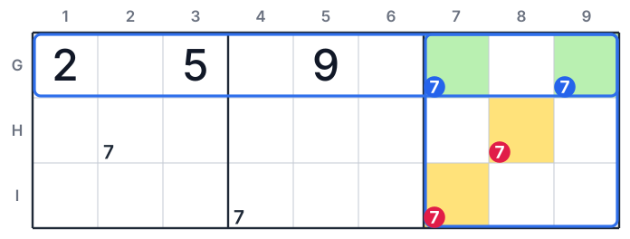
</p>

**Example (digit 7):**

1. Row G must contain a 7.
2. In row G, only G7 and G9 can contain 7. These two cells are in box 9.
3. The 7 of box 9 is in G7 or in G9.

**Result:** remove 7 from H8 and from I7.

Other name: Box/Line Reduction.

---

<p align="center"></p>

A fish uses one digit.
It has N base units and N cover units.
The base units are parallel rows. The cover units are parallel columns.
You can also use columns as base units and rows as cover units.

| Fish | Number of base rows | Number of cover columns |
|---|:-:|:-:|
| X-Wing | 2 | 2 |
| Swordfish | 3 | 3 |
| Jellyfish | 4 | 4 |

**General logic of all fish:**

1. Each base row must contain the digit one time.
2. In each base row, the digit is possible only in the cover columns.
3. Two cells of one column cannot contain the digit at the same time.
4. Thus the N base rows put the N digits into the N cover columns, one in each column.
5. The cover columns get their digit from the base rows. Remove the digit from all the other cells of the cover columns.

## 11. X-Wing

**Strategy:** in two rows, a digit is possible only in the same two columns.
Remove the digit from all the other cells of these two columns.

<p align="center">
  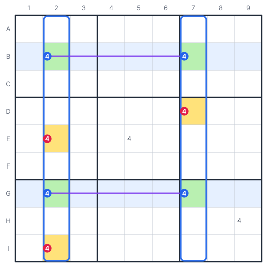
</p>

**Example (digit 4):**

1. In row B, only B2 and B7 can contain 4.
2. In row G, only G2 and G7 can contain 4.
3. If B2 is 4, then G2 is not 4. Thus G7 is 4.
4. If B7 is 4, then G7 is not 4. Thus G2 is 4.
5. In the two conditions, column 2 and column 7 get their 4 from rows B and G.

**Result:** remove 4 from E2, I2 and D7. The 4 in E5 and in H9 stays.

The four cells make a rectangle. The two possible conditions make the shape of an "X".

---

## 12. Swordfish

**Strategy:** in three rows, a digit is possible only in the same three columns.
Remove the digit from all the other cells of these three columns.

<p align="center">
  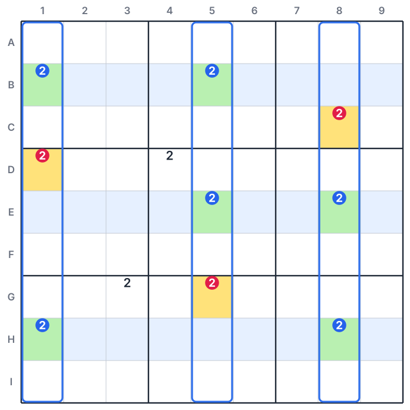
</p>

**Example (digit 2):**

1. In row B, the 2 is possible in columns 1 and 5.
2. In row E, the 2 is possible in columns 5 and 8.
3. In row H, the 2 is possible in columns 1 and 8.
4. The three rows put three 2s into the columns 1, 5 and 8, one in each column.

**Result:** remove 2 from D1, G5 and C8. The 2 in D4 and in G3 stays.

> [!NOTE]
> A base row can have two or three candidates. It does not have to have three.

---

## 13. Jellyfish

**Strategy:** in four rows, a digit is possible only in the same four columns.
Remove the digit from all the other cells of these four columns.

<p align="center">
  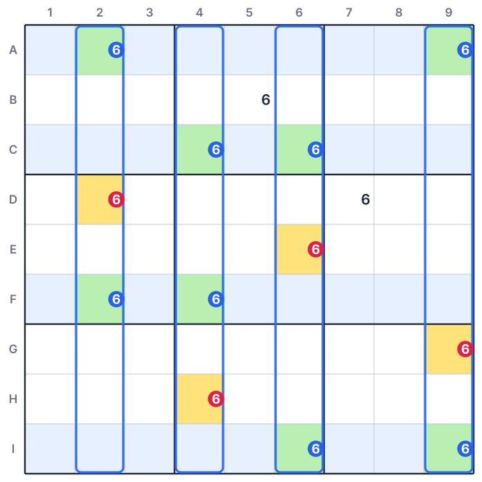
</p>

**Example (digit 6):**

1. The base rows are A, C, F and I.
2. In these rows, the 6 is possible only in the columns 2, 4, 6 and 9.
3. The four rows put four 6s into these four columns, one in each column.

**Result:** remove 6 from D2, E6, H4 and G9. The 6 in B5 and in D7 stays.

---

<p align="center"></p>

The strategies of level 5 use one digit and a short chain of links:
**strong link → weak link → strong link**.

**General logic:**

1. The two candidates in the center of the chain are peers. They cannot be correct at the same time.
2. Thus one of them is not correct. Its strong link then makes the end of the chain on its side correct.
3. One of the two ends is correct. You do not know which end.
4. A cell that is a peer of the two ends cannot contain the digit.

## 14. Skyscraper

**Strategy:** two columns each have a strong link on the same digit.
The two links have their bottom ends in the same row.
Remove the digit from the cells that are peers of the two top ends.

<p align="center">
  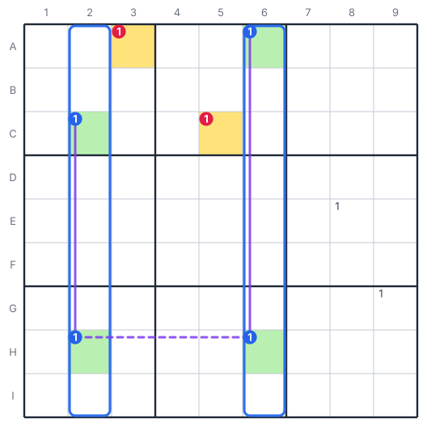
</p>

**Example (digit 1):**

1. In column 2, only C2 and H2 can contain 1. This is a strong link.
2. In column 6, only A6 and H6 can contain 1. This is a strong link.
3. H2 and H6 are in row H. They cannot contain 1 at the same time.
4. If H2 is not 1, then C2 is 1. If H6 is not 1, then A6 is 1.
5. Thus C2 or A6 is 1. These two cells are the top ends of the two links.

**Result:**

| Cell | Peer of C2 by | Peer of A6 by | Remove |
|:-:|---|---|:-:|
| A3 | box 1 | row A | 1 |
| C5 | row C | box 2 | 1 |

---

## 15. 2-String Kite

**Strategy:** a digit has a strong link in a row and a strong link in a column.
One end of each link is in the same box.
Remove the digit from the cell that is a peer of the two other ends.

<p align="center">
  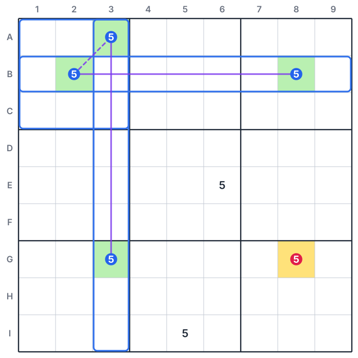
</p>

**Example (digit 5):**

1. In row B, only B2 and B8 can contain 5.
2. In column 3, only A3 and G3 can contain 5.
3. B2 and A3 are in box 1. They cannot contain 5 at the same time.
4. If B2 is not 5, then B8 is 5. If A3 is not 5, then G3 is 5.
5. Thus B8 or G3 is 5.
6. Cell G8 is a peer of B8 (column 8) and of G3 (row G).

**Result:** remove 5 from G8.

---

## 16. Turbot Fish

**Strategy:** a digit makes the chain strong link → weak link → strong link.
Remove the digit from the cells that are peers of the two ends of the chain.

The Skyscraper and the 2-String Kite are two types of Turbot Fish.
The Turbot Fish is the general type. Its strong links can be in a row, in a column or in a box.

<p align="center">
  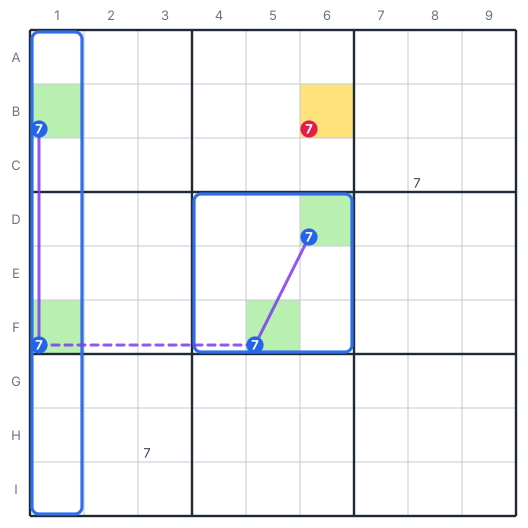
</p>

**Example (digit 7):**

1. In column 1, only B1 and F1 can contain 7. This is the first strong link.
2. F1 and F5 are in row F. This is the weak link.
3. In box 5, only F5 and D6 can contain 7. This is the other strong link.
4. F1 and F5 cannot contain 7 at the same time.
5. If F1 is not 7, then B1 is 7. If F5 is not 7, then D6 is 7.
6. Thus B1 or D6 is 7. Cell B6 is a peer of B1 (row B) and of D6 (column 6).

**Result:** remove 7 from B6.

Other name: Turbo Fish (in some apps).

---

## 17. Empty Rectangle

**Strategy:** in a box, all the candidates of a digit are in one row and one column of the box.
A strong link on the same digit has one end in that row, but not in the box.
Find the other end of the strong link.
Remove the digit from the cell that is in the row of this end and in the column of the box.

The four corner cells of the box have no candidate for the digit. Thus the name is "Empty Rectangle".

<p align="center">
  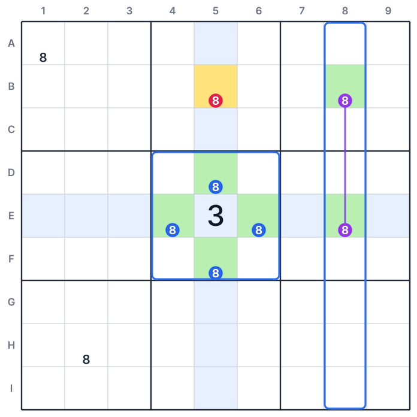
</p>

**Example (digit 8):**

1. In box 5, the 8 is possible only in row E (E4, E6) and in column 5 (D5, F5).
2. Box 5 must contain an 8. The 8 is in row E or in column 5.
3. In column 8, only B8 and E8 can contain 8. This is a strong link.
4. Condition 1: B8 is 8. Then B5 is not 8, because B5 is in row B.
5. Condition 2: E8 is 8. Then E4 and E6 are not 8. The 8 of box 5 is in D5 or F5, in column 5. Then B5 is not 8.
6. In the two conditions, B5 is not 8.

**Result:** remove 8 from B5.

---

<p align="center"></p>

A wing has a pivot cell and two or more pincer cells.
Each pincer is a peer of the pivot.
All the possible digits of the pivot make the same digit Z correct in one cell of the wing.
A cell that is a peer of all the Z candidates of the wing cannot contain Z.

## 18. XY-Wing

**Strategy:** a pivot has the candidates X and Y. One pincer has X and Z. The other pincer has Y and Z.
Remove Z from the cells that are peers of the two pincers.

<p align="center">
  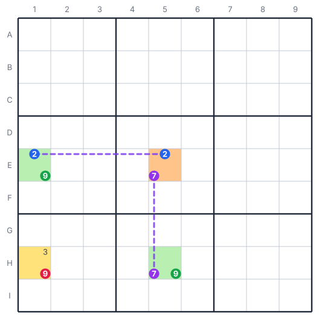
</p>

**Example (X = 2, Y = 7, Z = 9):**

1. The pivot E5 has the candidates 2 and 7.
2. The pincer E1 has 2 and 9. E1 is a peer of E5 (row E).
3. The pincer H5 has 7 and 9. H5 is a peer of E5 (column 5).
4. If E5 is 2, then E1 is not 2. Thus E1 is 9.
5. If E5 is 7, then H5 is not 7. Thus H5 is 9.
6. Thus E1 or H5 is 9. Cell H1 is a peer of E1 (column 1) and of H5 (row H).

**Result:** remove 9 from H1.

Other name: Y-Wing (in many Sudoku guides).

---

## 19. XYZ-Wing

**Strategy:** a pivot has the candidates X, Y and Z. One pincer has X and Z. The other pincer has Y and Z.
Remove Z from the cells that are peers of the pivot and of the two pincers.

<p align="center">
  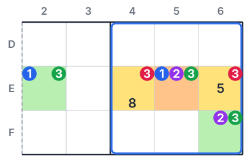
</p>

**Example (Z = 3):**

1. The pivot E5 has the candidates 1, 2 and 3.
2. The pincer E2 has 1 and 3 (row E). The pincer F6 has 2 and 3 (box 5).
3. If E5 is 1, then E2 is 3.
4. If E5 is 2, then F6 is 3.
5. If E5 is 3, then the pivot is 3.
6. Thus one of the three cells contains 3.
7. Cells E4 and E6 are peers of the three cells.

**Result:** remove 3 from E4 and from E6.

> [!IMPORTANT]
> The pivot also has Z. Thus the cell for the result must be a peer of the pivot too.

---

## 20. WXYZ-Wing

**Strategy:** four cells have together only four digits.
For three of the digits, all their candidates in the four cells are peers of each other.
Remove the other digit Z from the cells that are peers of all the Z candidates in the four cells.

<p align="center">
  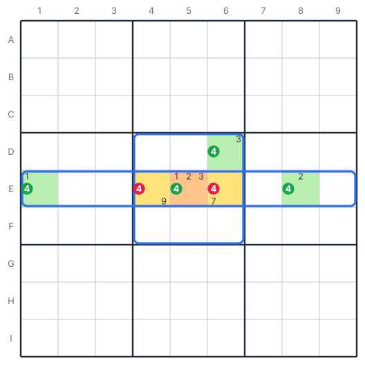
</p>

**Example (Z = 4):**

1. The pivot E5 has 1, 2, 3 and 4. The pincers are E1 (1 and 4), E8 (2 and 4) and D6 (3 and 4).
2. The digit 1 is in E1 and E5. These cells are peers (row E).
3. The digit 2 is in E5 and E8. These cells are peers (row E).
4. The digit 3 is in E5 and D6. These cells are peers (box 5).
5. Thus the digits 1, 2 and 3 can each be in only one of the four cells.
6. Four cells must contain four digits. The digits 1, 2 and 3 can fill only three cells.
7. Thus one or more of the four cells contains 4.
8. Cells E4 and E6 are peers of E1, E5, E8 and D6.

**Result:** remove 4 from E4 and from E6.

---

## 21. W-Wing

**Strategy:** two bivalue cells have the same two candidates X and Z. The two cells are not peers.
A strong link on X connects a peer of one cell to a peer of the other cell.
Remove Z from the cells that are peers of the two bivalue cells.

<p align="center">
  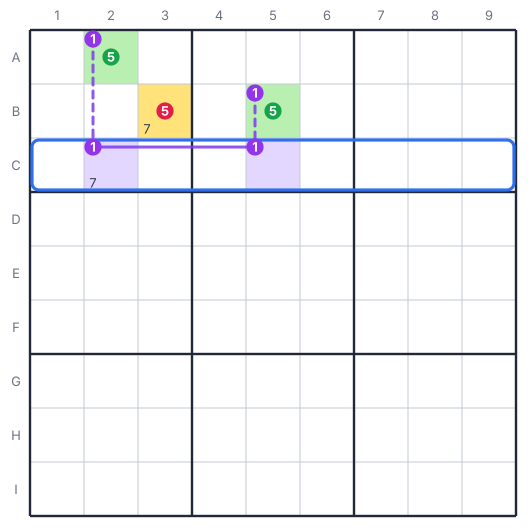
</p>

**Example (X = 1, Z = 5):**

1. Cells A2 and B5 have the candidates 1 and 5.
2. In row C, only C2 and C5 can contain 1. This is a strong link.
3. C2 is a peer of A2 (column 2). C5 is a peer of B5 (column 5).
4. If A2 is not 5, then A2 is 1. Then C2 is not 1.
5. Then C5 is 1, and B5 is not 1. Then B5 is 5.
6. Thus A2 or B5 is 5. Cell B3 is a peer of A2 (box 1) and of B5 (row B).

**Result:** remove 5 from B3.

> [!NOTE]
> Some apps use the name "Y-Wing" for this pattern. Other Sudoku guides use the name "Y-Wing" for the XY-Wing.

---

<p align="center"></p>

## 22. XY-Chain

**Strategy:** a chain of bivalue cells starts with the digit Z and ends with the digit Z.
Each cell in the chain is a peer of the next cell. The two cells have one digit that is the same.
Remove Z from the cells that are peers of the two ends.

**Logic:**
Start at the first cell. Make it "not Z".
Then the first cell contains its other digit.
This digit removes a candidate from the next cell.

Each cell in the chain then has only one digit.
At the end, the last cell contains Z.
Thus one of the two ends contains Z.

<p align="center">
  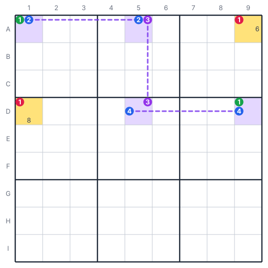
</p>

**Example (Z = 1):**

1. The chain is A1 (1, 2) → A5 (2, 3) → D5 (3, 4) → D9 (4, 1).
2. If A1 is not 1, then A1 is 2.
3. Then A5 is not 2. Thus A5 is 3.
4. Then D5 is not 3. Thus D5 is 4.
5. Then D9 is not 4. Thus D9 is 1.
6. Thus A1 or D9 is 1.

**Result:**

| Cell | Peer of A1 by | Peer of D9 by | Remove |
|:-:|---|---|:-:|
| A9 | row A | column 9 | 1 |
| D1 | column 1 | row D | 1 |

> [!TIP]
> An XY-Wing is a short XY-Chain with three cells.

---

<p align="center"></p>

## 23. BUG+1

BUG is the short name of "Bivalue Universal Grave".

**BUG grid:** all the empty cells are bivalue cells.
Also, in each unit, each candidate is in two cells only.

**Strategy:** all the empty cells are bivalue cells, but one cell has three candidates.
In that cell, one digit Z is a candidate three times in its row, its column and its box.
Write that digit in the cell.

**Logic:**

1. A BUG grid cannot have only one solution. It has no solution, or it has two or more solutions.
2. A correct puzzle has only one solution. Thus the puzzle cannot be a BUG grid.
3. Without the cell with three candidates, the grid is a BUG grid.
4. If this cell does not contain the digit Z, it has only two candidates. Then the grid is a BUG grid.
5. Thus the cell must contain the digit Z.

<p align="center">
  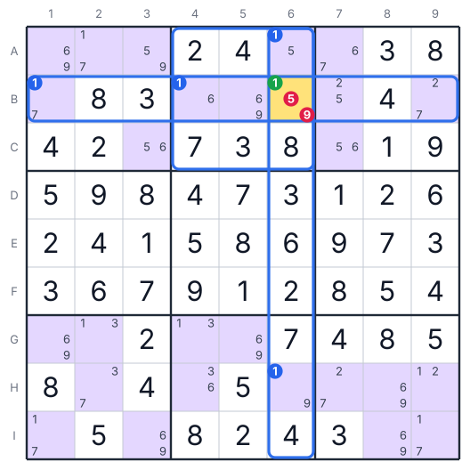
</p>

**Example:**

1. All the empty cells have two candidates, but cell B6 has three: 1, 5 and 9.
2. In row B, the digit 1 is a candidate in B1, B4 and B6: three times.
3. In column 6, the digit 1 is a candidate in A6, B6 and H6: three times.
4. In box 2, the digit 1 is a candidate in A6, B4 and B6: three times.
5. Thus Z is 1.

**Result:** write 1 in B6. Then the puzzle has only naked singles and hidden singles.

> [!WARNING]
> Use BUG+1 only on a puzzle that has only one solution.
> On a puzzle with two or more solutions, BUG+1 can give an incorrect result.

---

## Procedure for all puzzles

<p align="center"></p>

1. Write all the candidates in all the empty cells.
2. Find all the naked singles and hidden singles (level 1).
3. After each new digit, remove that digit from the candidates of its peers.
4. If level 1 gives no result, use the strategies of level 2.
5. When a strategy gives a result, go back to level 1.
6. If a level gives no result, go to the next level.
7. Continue until the grid is full.

> [!CAUTION]
> Do not write a digit in a cell when you are not sure.
> One incorrect digit can make the full grid incorrect.

---

## About the examples

- The folder `figures/` contains all the figures of this guide as SVG files.
- The script `tools/build_figures.py` makes all the figures.
- The same script examines each example. It finds all the possible sets of digits for the cells in the figure. Then it makes sure that each removed candidate is not correct in each set.
- The BUG+1 grid is a full and correct grid. The script makes sure that it has only one solution, and that B6 without the 1 gives no solution.

To make the figures again, use this command in the folder of this guide:

```bash
python3 tools/build_figures.py
```
