<p align="center">
  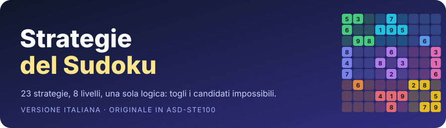
</p>

# Strategie del Sudoku

🇮🇹 Versione italiana (questa pagina) · 🇬🇧 [English version](README.en.md)

Questa guida spiega la logica di 23 strategie del Sudoku.
Per ogni strategia trovi lo schema da cercare, la sua logica e un esempio.
Uno script Python ha verificato ogni esempio: sono tutti corretti.

> [!NOTE]
> La versione originale in inglese è scritta in ASD-STE100 Simplified Technical English.
> Questa traduzione segue lo stesso stile: frasi brevi, un'idea per frase, termini sempre uguali.
> Lo standard STE esiste solo per l'inglese, quindi questa versione non è STE in senso stretto.
> La sezione [Termini tecnici](#termini-tecnici) spiega le parole proprie del Sudoku.

---

## Indice

<p align="center">
  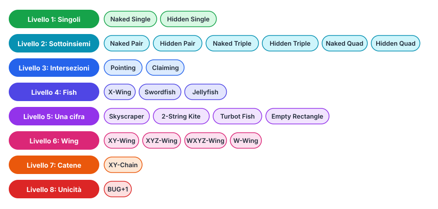
</p>

| Livello | Gruppo | Strategie |
|:-:|---|---|
| 1 | Singoli | [Naked Single](#1-naked-single) · [Hidden Single](#2-hidden-single) |
| 2 | Sottoinsiemi | [Naked Pair](#3-naked-pair) · [Hidden Pair](#4-hidden-pair) · [Naked Triple](#5-naked-triple) · [Hidden Triple](#6-hidden-triple) · [Naked Quad](#7-naked-quad) · [Hidden Quad](#8-hidden-quad) |
| 3 | Intersezioni | [Pointing](#9-pointing) · [Claiming](#10-claiming) |
| 4 | Fish | [X-Wing](#11-x-wing) · [Swordfish](#12-swordfish) · [Jellyfish](#13-jellyfish) |
| 5 | Catene su una cifra | [Skyscraper](#14-skyscraper) · [2-String Kite](#15-2-string-kite) · [Turbot Fish](#16-turbot-fish) · [Empty Rectangle](#17-empty-rectangle) |
| 6 | Wing | [XY-Wing](#18-xy-wing) · [XYZ-Wing](#19-xyz-wing) · [WXYZ-Wing](#20-wxyz-wing) · [W-Wing](#21-w-wing) |
| 7 | Catene | [XY-Chain](#22-xy-chain) |
| 8 | Unicità | [BUG+1](#23-bug1) |

Altre sezioni:
[La griglia](#la-griglia) ·
[Termini tecnici](#termini-tecnici) ·
[Colori nelle figure](#colori-nelle-figure) ·
[Procedura generale](#procedura-generale) ·
[Gli esempi](#gli-esempi)

> [!TIP]
> I nomi delle strategie restano in inglese. Sono i nomi usati nelle app e nella letteratura sul Sudoku.
> Accanto a ogni nome trovi la traduzione italiana.

---

## La griglia

<p align="center">
  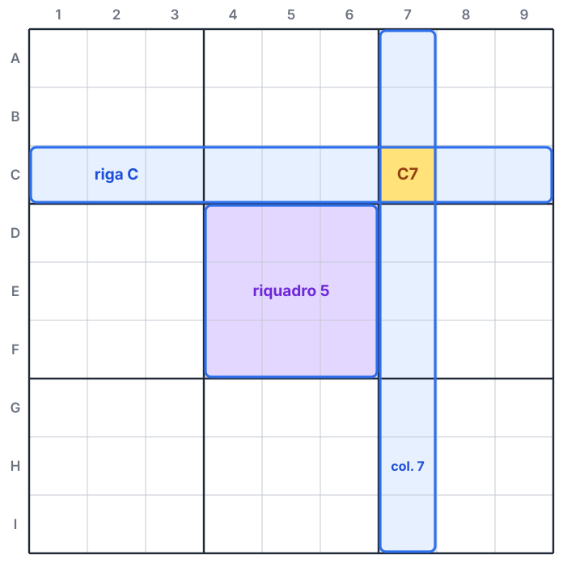
</p>

Una griglia di Sudoku ha 81 celle.
Le righe hanno le lettere da A a I, dall'alto verso il basso.
Le colonne hanno i numeri da 1 a 9, da sinistra verso destra.
Il nome di una cella è la lettera della riga seguita dal numero della colonna.
Per esempio, la cella C7 è nella riga C e nella colonna 7.

La griglia ha nove riquadri di 3 × 3 celle.
I riquadri hanno i numeri da 1 a 9, dall'alto a sinistra fino in basso a destra.

**La regola del Sudoku:** ogni riga, ogni colonna e ogni riquadro contiene le cifre da 1 a 9, una volta sola.

Tutte le strategie di questa guida derivano solo da questa regola.
Ogni strategia dà uno di questi due risultati:

1. Trova la cifra corretta di una cella.
2. Toglie un candidato da una cella.

---

## Termini tecnici

| Termine | Significato |
|---|---|
| **Cella** | La casella più piccola della griglia. Contiene una cifra. |
| **Unità** | Una riga, una colonna o un riquadro. Ogni unità ha 9 celle. |
| **Cifra data** | Una cifra presente nella griglia fin dall'inizio. |
| **Candidato** | Una cifra ancora possibile in una cella vuota. |
| **Celle che si vedono** | Due celle si vedono quando sono nella stessa unità. Due celle che si vedono non possono contenere la stessa cifra. |
| **Cella bivalore** | Una cella vuota con due soli candidati. |
| **Schema** | Il gruppo di celle e candidati che una strategia usa. |
| **Legame forte** | Una relazione tra due candidati: se uno non è corretto, l'altro è corretto. Esempio: una cifra ha solo due candidati in un'unità. |
| **Legame debole** | Una relazione tra due candidati: se uno è corretto, l'altro non è corretto. Esempio: due candidati della stessa cifra in due celle che si vedono. |
| **Perno** | La cella centrale di un wing. |
| **Pinza** | Una cella all'estremità di un wing. |
| **Unità di base** | Un'unità da cui parte uno schema fish. |
| **Unità di copertura** | Un'unità in cui uno schema fish toglie candidati. |
| **Soluzione** | La griglia completa, con tutte le 81 cifre. Un puzzle corretto ha una sola soluzione. |

> [!TIP]
> Un legame forte è anche un legame debole, quando i due candidati si vedono.
> Le catene usano questo fatto: passano da un legame forte a uno debole, poi di nuovo a uno forte.

---

## Colori nelle figure

<p align="center">
  
</p>

Le figure mostrano solo i candidati che contano per la strategia.
Alcune figure mostrano una sola cifra: in questo caso compaiono tutti i candidati di quella cifra.
Un bordo grigio tratteggiato indica che la griglia continua oltre la figura.

---

<p align="center"></p>

## 1. Naked Single

*Singolo nudo*

**Strategia:** se una cella ha un solo candidato, quel candidato è la cifra corretta.

**Logica:**
Le celle che la vedono contengono alcune cifre.
La cella non può contenere nessuna di queste cifre.
Quando le celle che la vedono contengono otto cifre diverse, per la cella resta una sola cifra.

<p align="center">
  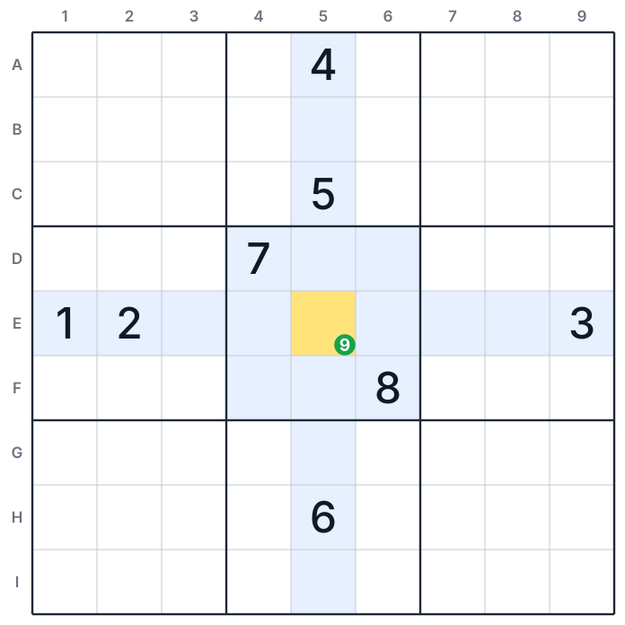
</p>

**Esempio:**

1. Esamina le celle che vedono E5.
2. La riga E contiene 1, 2 e 3.
3. La colonna 5 contiene 4, 5 e 6.
4. Il riquadro 5 contiene 7 e 8.
5. Le celle che vedono E5 contengono le cifre da 1 a 8. Resta solo il 9.

**Risultato:** scrivi 9 nella cella E5.

---

## 2. Hidden Single

*Singolo nascosto*

**Strategia:** se in un'unità una cifra può stare in una sola cella, quella cella contiene la cifra.

**Logica:**
Ogni unità deve contenere ogni cifra.
Una cella può avere molti candidati.
Ma se una cifra è possibile in una sola cella dell'unità, la cifra deve stare in quella cella.
Gli altri candidati della cella rendono questa cifra difficile da vedere: per questo il singolo è "nascosto".

<p align="center">
  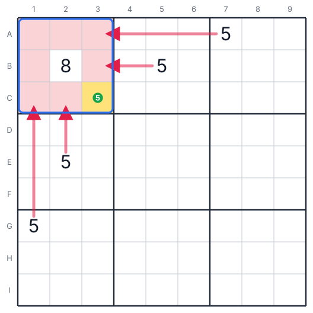
</p>

**Esempio:**

1. Il riquadro 1 deve contenere un 5. Cerca le celle del riquadro 1 che possono contenerlo.
2. La cella A7 contiene un 5. La riga A non può avere un altro 5: A1, A2 e A3 sono escluse.
3. La cella B5 contiene un 5. B1 e B3 sono escluse. B2 contiene già l'8.
4. La cella G1 contiene un 5. La colonna 1 non può avere un altro 5: C1 è esclusa.
5. La cella E2 contiene un 5. C2 è esclusa.
6. Nel riquadro 1, solo la cella C3 può contenere il 5.

**Risultato:** scrivi 5 nella cella C3.

---

<p align="center"></p>

## 3. Naked Pair

*Coppia nuda*

**Strategia:** due celle della stessa unità hanno gli stessi due candidati, e nessun altro.
Togli queste due cifre da tutte le altre celle dell'unità.

**Logica:**
Le due celle devono contenere le due cifre.
Se una cella contiene una delle due cifre, l'altra cella contiene l'altra cifra.
In entrambi i casi, le due cifre stanno in queste due celle.
Nessun'altra cella dell'unità può contenerle.

<p align="center">
  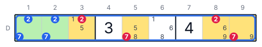
</p>

**Esempio (riga D):**

1. Le celle D1 e D2 hanno solo i candidati 2 e 7.
2. Se D1 è 2, allora D2 è 7. Se D1 è 7, allora D2 è 2.
3. Il 2 e il 7 stanno in D1 e D2. Non possono stare in altre celle della riga D.

**Risultato:**

| Cella | Togli |
|:-:|:-:|
| D3 | 2 |
| D8 | 2 |
| D5 | 7 |
| D9 | 7 |

Dopo questo passo, D9 ha solo il candidato 9: è un Naked Single.

> [!TIP]
> Se le due celle sono anche nello stesso riquadro, togli le due cifre anche dal riquadro.

---

## 4. Hidden Pair

*Coppia nascosta*

**Strategia:** in un'unità, due cifre sono candidate solo nelle stesse due celle.
Togli tutti gli altri candidati da queste due celle.

**Logica:**
L'unità deve contenere le due cifre.
Solo due celle possono contenerle.
Quindi una cella contiene una cifra e l'altra cella contiene l'altra.
Queste due celle non possono contenere una cifra diversa.

<p align="center">
  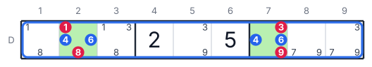
</p>

**Esempio (riga D):**

1. Cerca le celle della riga D che possono contenere il 4: solo D2 e D7.
2. Cerca le celle della riga D che possono contenere il 6: solo D2 e D7.
3. Il 4 e il 6 devono stare in D2 e D7.

**Risultato:**

| Cella | Togli |
|:-:|:-:|
| D2 | 1 e 8 |
| D7 | 3 e 9 |

Dopo questo passo, D2 e D7 formano un Naked Pair.

---

## 5. Naked Triple

*Tripla nuda*

**Strategia:** tre celle della stessa unità hanno candidati presi solo da tre cifre.
Togli queste tre cifre da tutte le altre celle dell'unità.

**Logica:**
Tre celle devono contenere tre cifre diverse.
Queste celle hanno solo tre cifre possibili.
Quindi le tre celle usano le tre cifre.
Nessun'altra cella dell'unità può contenerle.

> [!IMPORTANT]
> Non serve che ogni cella della tripla abbia tutte e tre le cifre.
> Nell'esempio, ogni cella ha solo due delle tre cifre.

<p align="center">
  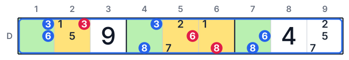
</p>

**Esempio (riga D):**

1. La cella D1 ha i candidati 3 e 6.
2. La cella D4 ha i candidati 3 e 8.
3. La cella D7 ha i candidati 6 e 8.
4. Insieme, le tre celle hanno solo le cifre 3, 6 e 8.

**Risultato:**

| Cella | Togli |
|:-:|:-:|
| D2 | 3 |
| D5 | 6 |
| D6 | 8 |

Dopo questo passo, D6 ha solo il candidato 1: è un Naked Single.

---

## 6. Hidden Triple

*Tripla nascosta*

**Strategia:** in un'unità, tre cifre sono candidate solo in tre celle.
Togli tutti gli altri candidati da queste tre celle.

**Logica:**
L'unità deve contenere le tre cifre.
Solo tre celle possono contenerle.
Quindi queste tre celle contengono queste tre cifre, e nessun'altra.

<p align="center">
  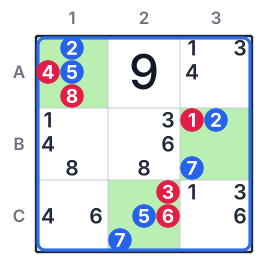
</p>

**Esempio (riquadro 1):**

1. La cifra 2 è candidata solo in A1 e B3.
2. La cifra 5 è candidata solo in A1 e C2.
3. La cifra 7 è candidata solo in B3 e C2.
4. Il 2, il 5 e il 7 devono stare nelle tre celle A1, B3 e C2.

**Risultato:**

| Cella | Togli |
|:-:|:-:|
| A1 | 4 e 8 |
| B3 | 1 |
| C2 | 3 e 6 |

---

## 7. Naked Quad

*Quadrupla nuda*

**Strategia:** quattro celle della stessa unità hanno candidati presi solo da quattro cifre.
Togli queste quattro cifre da tutte le altre celle dell'unità.

**Logica:**
È la stessa logica del Naked Pair e del Naked Triple.
Quattro celle devono contenere quattro cifre diverse, e hanno solo quattro cifre possibili.

<p align="center">
  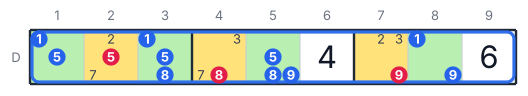
</p>

**Esempio (riga D):**

1. Le celle D1, D3, D5 e D8 hanno solo le cifre 1, 5, 8 e 9.
2. Queste quattro cifre devono stare in queste quattro celle.

**Risultato:**

| Cella | Togli |
|:-:|:-:|
| D2 | 5 |
| D4 | 8 |
| D7 | 9 |

---

## 8. Hidden Quad

*Quadrupla nascosta*

**Strategia:** in un'unità, quattro cifre sono candidate solo in quattro celle.
Togli tutti gli altri candidati da queste quattro celle.

<p align="center">
  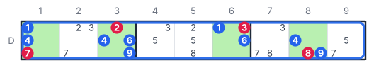
</p>

**Esempio (riga D):**

1. Le cifre 1, 4, 6 e 9 sono candidate solo in D1, D3, D6 e D8.
2. Queste quattro cifre devono stare in queste quattro celle.

**Risultato:**

| Cella | Togli |
|:-:|:-:|
| D1 | 7 |
| D3 | 2 |
| D6 | 3 |
| D8 | 8 |

> [!TIP]
> **Ogni sottoinsieme nudo ha un sottoinsieme nascosto nella stessa unità.**
> Conta le celle vuote di un'unità. Se un sottoinsieme nudo ne usa alcune, le altre celle vuote formano un sottoinsieme nascosto.
> Cerca quello con meno celle: è più facile da trovare.

| Numero di celle | Nudo (celle → cifre) | Nascosto (cifre → celle) |
|:-:|---|---|
| 2 | Naked Pair | Hidden Pair |
| 3 | Naked Triple | Hidden Triple |
| 4 | Naked Quad | Hidden Quad |

---

<p align="center"></p>

Le strategie del livello 3 usano le celle che stanno in un riquadro e anche in una riga (o in una colonna).
Insieme si chiamano **Intersection Removal** (eliminazione per intersezione).

## 9. Pointing

*Candidati che puntano*

**Strategia:** in un riquadro, una cifra è candidata solo in una riga (o in una colonna).
Togli quella cifra dalle celle di quella riga (o colonna) che sono fuori dal riquadro.

**Logica:**
Il riquadro deve contenere la cifra.
Tutti i candidati della cifra nel riquadro stanno in una sola riga.
Quindi la cifra di quella riga sta nel riquadro.
Le altre celle della riga non possono contenerla.

<p align="center">
  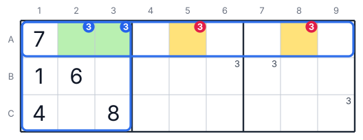
</p>

**Esempio (cifra 3):**

1. Il riquadro 1 deve contenere un 3.
2. Nel riquadro 1, solo A2 e A3 possono contenere il 3. Le due celle sono nella riga A.
3. Il 3 della riga A sta in A2 o in A3.

**Risultato:** togli il 3 da A5 e da A8.

---

## 10. Claiming

*Riga che reclama il riquadro*

**Strategia:** in una riga (o in una colonna), una cifra è candidata solo dentro un riquadro.
Togli quella cifra dalle altre celle di quel riquadro.

**Logica:**
La riga deve contenere la cifra.
Tutti i candidati della cifra nella riga stanno in un solo riquadro.
Quindi la cifra di quel riquadro sta nella riga.
Le altre celle del riquadro non possono contenerla.

<p align="center">
  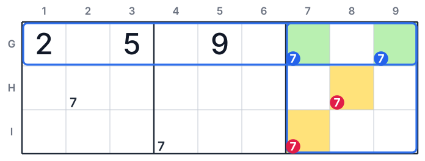
</p>

**Esempio (cifra 7):**

1. La riga G deve contenere un 7.
2. Nella riga G, solo G7 e G9 possono contenere il 7. Le due celle sono nel riquadro 9.
3. Il 7 del riquadro 9 sta in G7 o in G9.

**Risultato:** togli il 7 da H8 e da I7.

Altro nome: Box/Line Reduction.

---

<p align="center"></p>

Un fish ("pesce") usa una sola cifra.
Ha N unità di base e N unità di copertura.
Le unità di base sono righe, le unità di copertura sono colonne.
Puoi anche invertire i ruoli: colonne come base e righe come copertura.

| Fish | Righe di base | Colonne di copertura |
|---|:-:|:-:|
| X-Wing | 2 | 2 |
| Swordfish | 3 | 3 |
| Jellyfish | 4 | 4 |

**Logica comune a tutti i fish:**

1. Ogni riga di base deve contenere la cifra una volta.
2. In ogni riga di base, la cifra è possibile solo nelle colonne di copertura.
3. Due celle della stessa colonna non possono contenere la cifra entrambe.
4. Quindi le N righe di base mettono N cifre nelle N colonne di copertura, una per colonna.
5. Ogni colonna di copertura riceve la sua cifra dalle righe di base. Togli la cifra da tutte le altre celle delle colonne di copertura.

## 11. X-Wing

**Strategia:** in due righe, una cifra è possibile solo nelle stesse due colonne.
Togli la cifra da tutte le altre celle di queste due colonne.

<p align="center">
  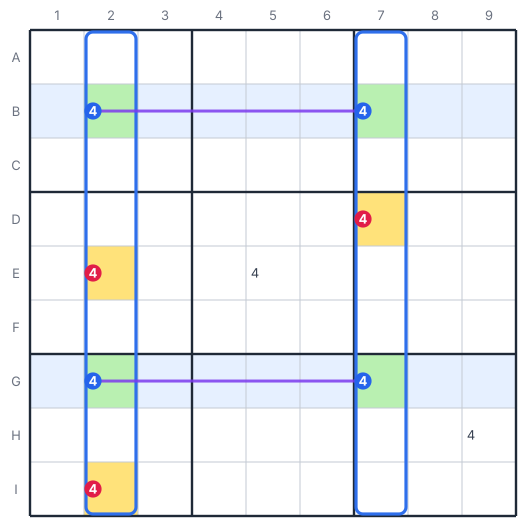
</p>

**Esempio (cifra 4):**

1. Nella riga B, solo B2 e B7 possono contenere il 4.
2. Nella riga G, solo G2 e G7 possono contenere il 4.
3. Se B2 è 4, allora G2 non è 4. Quindi G7 è 4.
4. Se B7 è 4, allora G7 non è 4. Quindi G2 è 4.
5. In entrambi i casi, le colonne 2 e 7 ricevono il loro 4 dalle righe B e G.

**Risultato:** togli il 4 da E2, I2 e D7. Il 4 in E5 e in H9 resta.

Le quattro celle formano un rettangolo. I due casi possibili disegnano una "X".

---

## 12. Swordfish

**Strategia:** in tre righe, una cifra è possibile solo nelle stesse tre colonne.
Togli la cifra da tutte le altre celle di queste tre colonne.

<p align="center">
  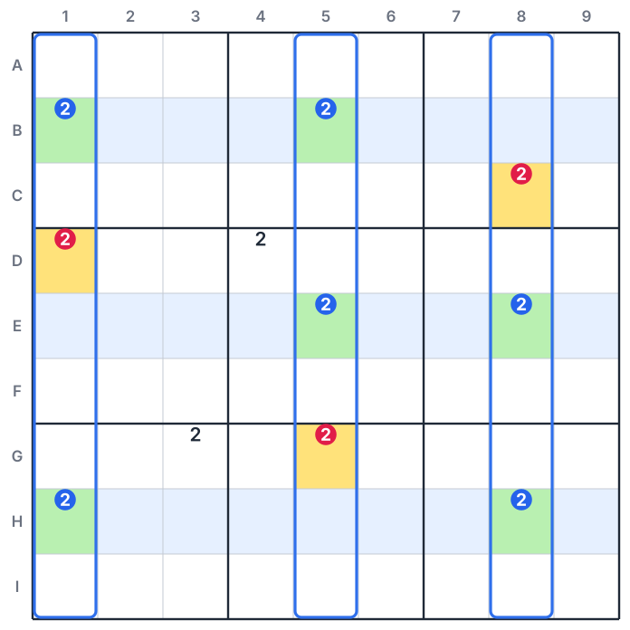
</p>

**Esempio (cifra 2):**

1. Nella riga B, il 2 è possibile nelle colonne 1 e 5.
2. Nella riga E, il 2 è possibile nelle colonne 5 e 8.
3. Nella riga H, il 2 è possibile nelle colonne 1 e 8.
4. Le tre righe mettono tre 2 nelle colonne 1, 5 e 8, uno per colonna.

**Risultato:** togli il 2 da D1, G5 e C8. Il 2 in D4 e in G3 resta.

> [!NOTE]
> Una riga di base può avere due o tre candidati. Non deve per forza averne tre.

---

## 13. Jellyfish

**Strategia:** in quattro righe, una cifra è possibile solo nelle stesse quattro colonne.
Togli la cifra da tutte le altre celle di queste quattro colonne.

<p align="center">
  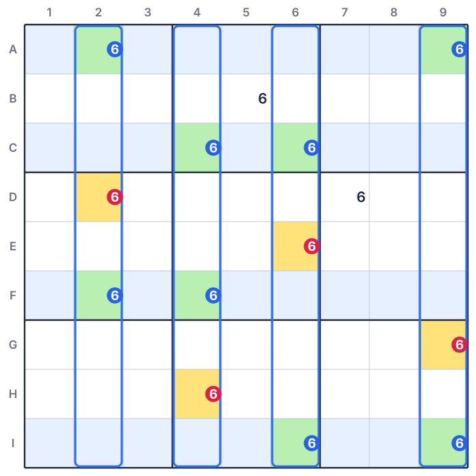
</p>

**Esempio (cifra 6):**

1. Le righe di base sono A, C, F e I.
2. In queste righe, il 6 è possibile solo nelle colonne 2, 4, 6 e 9.
3. Le quattro righe mettono quattro 6 in queste quattro colonne, uno per colonna.

**Risultato:** togli il 6 da D2, E6, H4 e G9. Il 6 in B5 e in D7 resta.

---

<p align="center"></p>

Le strategie del livello 5 usano una sola cifra e una catena corta:
**legame forte → legame debole → legame forte**.

**Logica comune:**

1. I due candidati al centro della catena si vedono: non possono essere corretti entrambi.
2. Quindi almeno uno dei due non è corretto. Il suo legame forte rende corretta l'estremità della catena dal suo lato.
3. Una delle due estremità è corretta. Non sai quale.
4. Una cella che vede entrambe le estremità non può contenere la cifra.

## 14. Skyscraper

*Grattacielo*

**Strategia:** due colonne hanno ciascuna un legame forte sulla stessa cifra.
Le estremità in basso dei due legami sono nella stessa riga.
Togli la cifra dalle celle che vedono entrambe le estremità in alto.

<p align="center">
  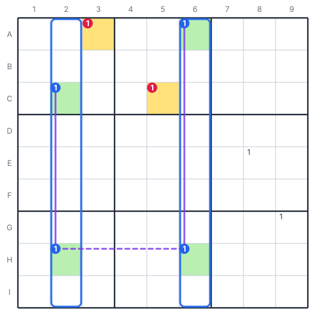
</p>

**Esempio (cifra 1):**

1. Nella colonna 2, solo C2 e H2 possono contenere l'1. È un legame forte.
2. Nella colonna 6, solo A6 e H6 possono contenere l'1. È un legame forte.
3. H2 e H6 sono nella riga H: non possono contenere l'1 entrambe.
4. Se H2 non è 1, allora C2 è 1. Se H6 non è 1, allora A6 è 1.
5. Quindi C2 o A6 è 1. Sono le cime dei due "grattacieli".

**Risultato:**

| Cella | Vede C2 tramite | Vede A6 tramite | Togli |
|:-:|---|---|:-:|
| A3 | riquadro 1 | riga A | 1 |
| C5 | riga C | riquadro 2 | 1 |

---

## 15. 2-String Kite

*Aquilone a due fili*

**Strategia:** una cifra ha un legame forte in una riga e un legame forte in una colonna.
Un'estremità di ciascun legame sta nello stesso riquadro.
Togli la cifra dalla cella che vede le altre due estremità.

<p align="center">
  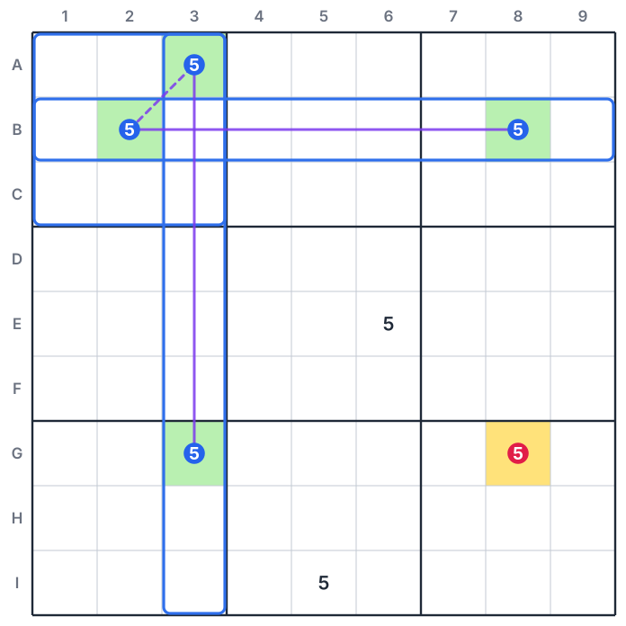
</p>

**Esempio (cifra 5):**

1. Nella riga B, solo B2 e B8 possono contenere il 5.
2. Nella colonna 3, solo A3 e G3 possono contenere il 5.
3. B2 e A3 sono nel riquadro 1: non possono contenere il 5 entrambe.
4. Se B2 non è 5, allora B8 è 5. Se A3 non è 5, allora G3 è 5.
5. Quindi B8 o G3 è 5.
6. La cella G8 vede B8 (colonna 8) e G3 (riga G).

**Risultato:** togli il 5 da G8.

---

## 16. Turbot Fish

*Rombo*

**Strategia:** una cifra forma la catena legame forte → legame debole → legame forte.
Togli la cifra dalle celle che vedono entrambe le estremità della catena.

Lo Skyscraper e il 2-String Kite sono due casi particolari del Turbot Fish.
Il Turbot Fish è la forma generale: i suoi legami forti possono stare in una riga, in una colonna o in un riquadro.

<p align="center">
  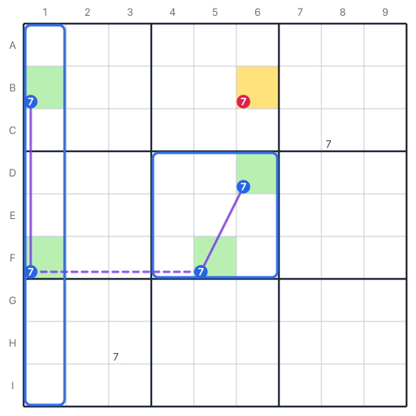
</p>

**Esempio (cifra 7):**

1. Nella colonna 1, solo B1 e F1 possono contenere il 7. È il primo legame forte.
2. F1 e F5 sono nella riga F. È il legame debole.
3. Nel riquadro 5, solo F5 e D6 possono contenere il 7. È l'altro legame forte.
4. F1 e F5 non possono contenere il 7 entrambe.
5. Se F1 non è 7, allora B1 è 7. Se F5 non è 7, allora D6 è 7.
6. Quindi B1 o D6 è 7. La cella B6 vede B1 (riga B) e D6 (colonna 6).

**Risultato:** togli il 7 da B6.

Altro nome: Turbo Fish (in alcune app).

---

## 17. Empty Rectangle

*Rettangolo vuoto*

**Strategia:** in un riquadro, tutti i candidati di una cifra stanno in una riga e in una colonna del riquadro.
Un legame forte sulla stessa cifra ha un'estremità in quella riga, ma fuori dal riquadro.
Trova l'altra estremità del legame forte.
Togli la cifra dalla cella che sta nella riga di questa estremità e nella colonna del riquadro.

Le quattro celle d'angolo del riquadro non hanno candidati per la cifra: da qui il nome "rettangolo vuoto".

<p align="center">
  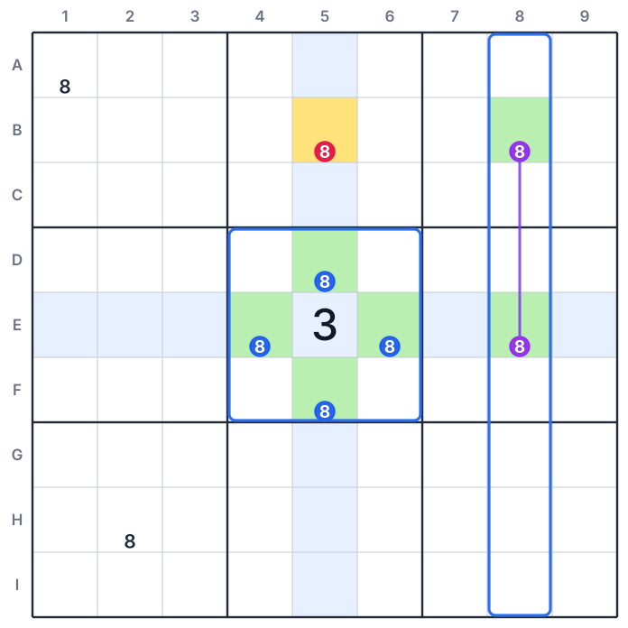
</p>

**Esempio (cifra 8):**

1. Nel riquadro 5, l'8 è possibile solo nella riga E (E4, E6) e nella colonna 5 (D5, F5).
2. Il riquadro 5 deve contenere un 8: sta nella riga E o nella colonna 5.
3. Nella colonna 8, solo B8 e E8 possono contenere l'8. È un legame forte.
4. Caso 1: B8 è 8. Allora B5 non è 8, perché B5 è nella riga B.
5. Caso 2: E8 è 8. Allora E4 e E6 non sono 8. L'8 del riquadro 5 sta in D5 o F5, nella colonna 5. Allora B5 non è 8.
6. In entrambi i casi, B5 non è 8.

**Risultato:** togli l'8 da B5.

---

<p align="center"></p>

Un wing ("ala") ha una cella perno e due o più celle pinza.
Ogni pinza vede il perno.
Qualunque cifra prenda il perno, la stessa cifra Z diventa corretta in una cella del wing.
Una cella che vede tutti i candidati Z del wing non può contenere Z.

## 18. XY-Wing

**Strategia:** il perno ha i candidati X e Y. Una pinza ha X e Z. L'altra pinza ha Y e Z.
Togli Z dalle celle che vedono entrambe le pinze.

<p align="center">
  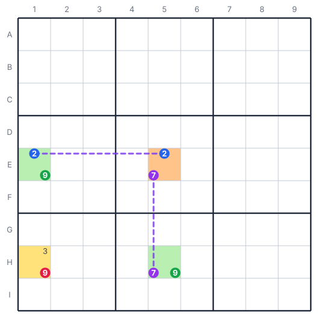
</p>

**Esempio (X = 2, Y = 7, Z = 9):**

1. Il perno E5 ha i candidati 2 e 7.
2. La pinza E1 ha 2 e 9. E1 vede E5 (riga E).
3. La pinza H5 ha 7 e 9. H5 vede E5 (colonna 5).
4. Se E5 è 2, allora E1 non è 2. Quindi E1 è 9.
5. Se E5 è 7, allora H5 non è 7. Quindi H5 è 9.
6. Quindi E1 o H5 è 9. La cella H1 vede E1 (colonna 1) e H5 (riga H).

**Risultato:** togli il 9 da H1.

Altro nome: Y-Wing (in molti manuali).

---

## 19. XYZ-Wing

**Strategia:** il perno ha i candidati X, Y e Z. Una pinza ha X e Z. L'altra pinza ha Y e Z.
Togli Z dalle celle che vedono il perno e le due pinze.

<p align="center">
  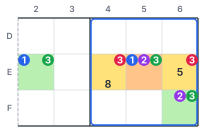
</p>

**Esempio (Z = 3):**

1. Il perno E5 ha i candidati 1, 2 e 3.
2. La pinza E2 ha 1 e 3 (riga E). La pinza F6 ha 2 e 3 (riquadro 5).
3. Se E5 è 1, allora E2 è 3.
4. Se E5 è 2, allora F6 è 3.
5. Se E5 è 3, il 3 sta nel perno.
6. Quindi una delle tre celle contiene il 3.
7. Le celle E4 ed E6 vedono tutte e tre le celle.

**Risultato:** togli il 3 da E4 e da E6.

> [!IMPORTANT]
> Anche il perno ha Z. Per questo la cella da cui togli Z deve vedere anche il perno.

---

## 20. WXYZ-Wing

**Strategia:** quattro celle hanno, tutte insieme, solo quattro cifre.
Per tre di queste cifre, tutti i candidati nelle quattro celle si vedono tra loro.
Togli la quarta cifra Z dalle celle che vedono tutti i candidati Z delle quattro celle.

<p align="center">
  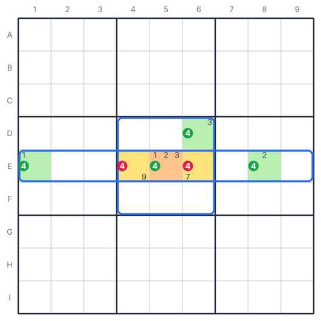
</p>

**Esempio (Z = 4):**

1. Il perno E5 ha 1, 2, 3 e 4. Le pinze sono E1 (1 e 4), E8 (2 e 4) e D6 (3 e 4).
2. L'1 sta in E1 ed E5, che si vedono (riga E).
3. Il 2 sta in E5 ed E8, che si vedono (riga E).
4. Il 3 sta in E5 e D6, che si vedono (riquadro 5).
5. Quindi l'1, il 2 e il 3 possono stare ciascuno in una sola delle quattro celle.
6. Quattro celle devono contenere quattro cifre. L'1, il 2 e il 3 riempiono al massimo tre celle.
7. Quindi almeno una delle quattro celle contiene il 4.
8. Le celle E4 ed E6 vedono E1, E5, E8 e D6.

**Risultato:** togli il 4 da E4 e da E6.

---

## 21. W-Wing

**Strategia:** due celle bivalore hanno gli stessi due candidati X e Z, e non si vedono.
Un legame forte su X collega una cella che vede la prima a una cella che vede la seconda.
Togli Z dalle celle che vedono entrambe le celle bivalore.

<p align="center">
  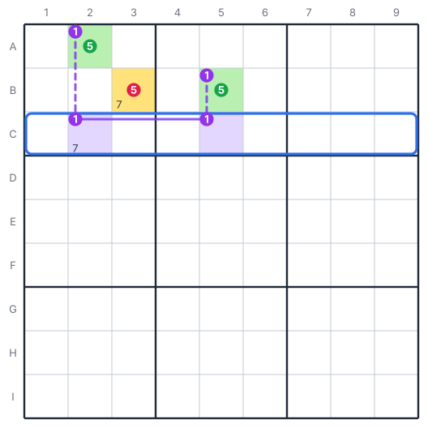
</p>

**Esempio (X = 1, Z = 5):**

1. Le celle A2 e B5 hanno i candidati 1 e 5.
2. Nella riga C, solo C2 e C5 possono contenere l'1. È un legame forte.
3. C2 vede A2 (colonna 2). C5 vede B5 (colonna 5).
4. Se A2 non è 5, allora A2 è 1. Allora C2 non è 1.
5. Allora C5 è 1, e B5 non è 1. Allora B5 è 5.
6. Quindi A2 o B5 è 5. La cella B3 vede A2 (riquadro 1) e B5 (riga B).

**Risultato:** togli il 5 da B3.

> [!NOTE]
> Alcune app chiamano "Y-Wing" questo schema. Molti manuali chiamano "Y-Wing" l'XY-Wing.

---

<p align="center"></p>

## 22. XY-Chain

*Catena XY*

**Strategia:** una catena di celle bivalore inizia con la cifra Z e finisce con la cifra Z.
Ogni cella della catena vede la successiva, e le due celle hanno una cifra in comune.
Togli Z dalle celle che vedono entrambe le estremità.

**Logica:**
Parti dalla prima cella e supponi che non sia Z.
Allora la prima cella contiene l'altra sua cifra.
Questa cifra toglie un candidato dalla cella successiva.

A catena, ogni cella resta con una sola cifra.
Alla fine, l'ultima cella contiene Z.
Quindi una delle due estremità contiene Z.

<p align="center">
  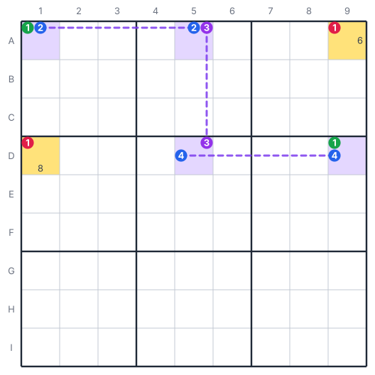
</p>

**Esempio (Z = 1):**

1. La catena è A1 (1, 2) → A5 (2, 3) → D5 (3, 4) → D9 (4, 1).
2. Se A1 non è 1, allora A1 è 2.
3. Allora A5 non è 2: A5 è 3.
4. Allora D5 non è 3: D5 è 4.
5. Allora D9 non è 4: D9 è 1.
6. Quindi A1 o D9 è 1.

**Risultato:**

| Cella | Vede A1 tramite | Vede D9 tramite | Togli |
|:-:|---|---|:-:|
| A9 | riga A | colonna 9 | 1 |
| D1 | colonna 1 | riga D | 1 |

> [!TIP]
> Un XY-Wing è un XY-Chain corto, di tre celle.

---

<p align="center"></p>

## 23. BUG+1

BUG è la sigla di "Bivalue Universal Grave" (tomba universale bivalore).

**Griglia BUG:** tutte le celle vuote sono bivalore, e in ogni unità ogni candidato compare in due celle sole.

**Strategia:** tutte le celle vuote sono bivalore, tranne una che ha tre candidati.
In quella cella, una cifra Z compare tre volte come candidata nella sua riga, nella sua colonna e nel suo riquadro.
Scrivi Z in quella cella.

**Logica:**

1. Una griglia BUG non può avere una sola soluzione: ne ha zero, oppure due o più.
2. Un puzzle corretto ha una sola soluzione. Quindi il puzzle non può essere una griglia BUG.
3. Senza la cella con tre candidati, la griglia sarebbe una griglia BUG.
4. Se questa cella non contiene Z, le restano due candidati e la griglia diventa una griglia BUG.
5. Quindi la cella deve contenere Z.

<p align="center">
  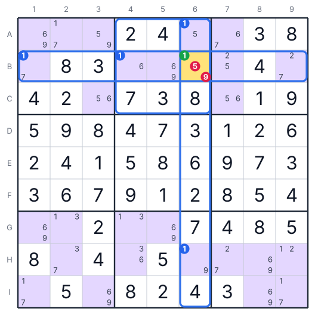
</p>

**Esempio:**

1. Tutte le celle vuote hanno due candidati, tranne B6 che ne ha tre: 1, 5 e 9.
2. Nella riga B, l'1 è candidato in B1, B4 e B6: tre volte.
3. Nella colonna 6, l'1 è candidato in A6, B6 e H6: tre volte.
4. Nel riquadro 2, l'1 è candidato in A6, B4 e B6: tre volte.
5. Quindi Z è 1.

**Risultato:** scrivi 1 in B6. Da qui il puzzle si risolve con Naked Single e Hidden Single.

> [!WARNING]
> Usa il BUG+1 solo su un puzzle con una sola soluzione.
> Su un puzzle con due o più soluzioni, il BUG+1 può dare un risultato sbagliato.

---

## Procedura generale

<p align="center"></p>

1. Scrivi tutti i candidati in tutte le celle vuote.
2. Cerca tutti i Naked Single e gli Hidden Single (livello 1).
3. Dopo ogni nuova cifra, toglila dai candidati delle celle che la vedono.
4. Se il livello 1 non dà risultati, usa le strategie del livello 2.
5. Quando una strategia dà un risultato, torna al livello 1.
6. Se un livello non dà risultati, passa al livello successivo.
7. Continua finché la griglia è completa.

> [!CAUTION]
> Non scrivere una cifra in una cella se non sei sicuro.
> Una sola cifra sbagliata può rendere sbagliata tutta la griglia.

---

## Gli esempi

- La cartella `figures/` contiene tutte le figure della guida in formato SVG.
- Lo script `tools/build_figures.py` genera tutte le figure, in inglese e in italiano.
- Lo stesso script verifica ogni esempio. Trova tutte le combinazioni di cifre possibili per le celle della figura, poi controlla che nessun candidato tolto sia corretto in alcuna combinazione.
- La griglia del BUG+1 è una griglia completa e corretta. Lo script controlla che abbia una sola soluzione, e che B6 senza l'1 non abbia soluzioni.
- Lo script `tools/ste_lint.py` controlla le regole di ASD-STE100 sulla versione inglese.

Per rigenerare le figure, esegui questo comando nella cartella della guida:

```bash
python3 tools/build_figures.py
```
